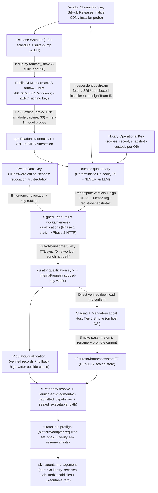

# CIP-0034: Automated Harness Qualification Registry and Sealed Binary Custody

- **Status:** Draft (revision 3; reserved in `curator-spec` PR #233 / `S0`; O1-O6 decided by owner 2026-11-26; O7 SealLink/hybrid timing open)
- **Owner:** Ivan Oparin (decision); author: Curator Architect
- **Created:** 2026-11-25
- **Updated:** 2026-11-27
- **Related:**
  - `curator-spec` PR #233 (`S0`: coordinated CIP-0034..0038 reservation and shared `launch-env-fragment-v8`)
  - [Audit Registry Protocol 1.0](../protocol/registry.md) (CCJ-1, Ed25519 envelopes, key rotation, deny-wins federation, monotonic snapshots, Merkle transparency log, offline bundles, TTL/grace cache)
  - [Curator Environments](../protocol/environments.md) (section 7.9 recorded tool versions, section 10.2 launch fragments, section 10.5 snapshot contract)
  - [CIP-0007](CIP-0007-manager-provisioned-cli-tools.md) (accepted Option B sealed read-only tool store, rotating registry keys, no compiled-in trust keys)
  - [CIP-0033](CIP-0033-antigravity-managed-home.md) (Antigravity CLI managed home, verified `agy 1.5.16` pin, P0-P9 probe precedent)
  - `CIP-0035` (Claude Code session surface projection: `surface.*` capabilities, Tier-0 `system/init` inventory, shared `launch-env-fragment-v8`)
  - `CIP-0036` (GUI-host managed sessions: `host.*` / `mcp.*` capabilities, `signed-app-bundle-v1`, local `host-smoke-receipt-v1`)
  - `curator/internal/registry/` (existing Audit Registry Protocol 1.0 client implementation)
  - `curator/docs/qualification/` (manual measurements for Claude Code, Codex CLI, and Muse)
  - `curator-agent-launcher` (GQ1 gateway qualification table and launch preflight)
  - `skill-agents-management` (`pkg/agentic` release-pinned yolo and managed-launch gates)
- **Affects:**
  - `curator-spec`: new normative protocol `protocol/harness-qualification.md`; additive schemas under `schemas/harness-qualification-v1/`; single shared `launch-env-fragment-v8` (combining CIP-0034 `qualification` and CIP-0035 `surface.setting_sources`, preserving frozen v1-v7); additive `binary_identity` note for `snapshot-launch-v2`; `protocol/environments.md` section 7.9 derived-view note; conformance vectors
  - `curator`: shared `internal/sealedstore` (also serving CIP-0007), `internal/qualification` (reusing `internal/registry` with scoped trust-bundle keys and unified centralized notary support for skills and binaries), `curator qualification sync|status|verify`, `curator harness install|list|verify|gc`, `curator env resolve` fragment projection
  - `curator-agent-launcher`: capability-based launch preflight (plus explicit operator warning-override flag), transitive session-to-binary `resume` affinity, retirement of static GQ1 build rows
  - `skill-agents-management`: pure-library `AdmittedCapabilities` and `ExecutablePath` inputs in `LaunchRequest`, interim `Q0-AGY` local Tier-0 smoke replacing hardcoded `agy` release pin, phased retirement of hardcoded per-release pins
  - Infrastructure / new public repositories: `relux-works/harness-qualification-suites` (probe suites as reviewed code), `relux-works/harness-qualifications` (append-only signed static feed), deterministic Go service/job `curator-qual-notary`
  - Swarma book: follow-up chapter on automated harness qualification and binary custody

---

## 1. Summary

Agent harnesses (`claude_code`, `codex_cli`, `muse`, `antigravity`, `opencode`, `pi`, `kimi_code`) ship vendor updates up to several times per day. Today, verified release facts are hand-maintained in three diverging places (`curator-spec` section 7.9, `skill-agents-management` release pins, and `curator-agent-launcher` GQ1 tables), while hard pins break lanes on the next vendor self-update and warn-only checks silently execute unqualified binaries.

This CIP introduces a **Harness Qualification Registry** built directly on Curator's existing **Audit Registry Protocol 1.0** (`protocol/registry.md`), aligned with **SealLink `v1.0.0-draft.12` (`PROFILE-artifact-v1`)** payload semantics while remaining usable without SealLink/Namecoin via a pluggable centralized notary, and pairs it with **Sealed Binary Custody** built on the accepted **CIP-0007** read-only content-addressed store design:

1. **Automated two-layer qualification:** Scheduled public CI runners execute versioned probe suites (Tier-0 offline deterministic probes plus minimal-budget Tier-1 model probes) and emit raw structured evidence (`qualification-evidence-v1`) bound by GitHub OIDC attestation. No long-lived signing key ever touches a public runner.
2. **Deterministic Unified Notary (`curator-qual-notary`, pure code, never an LLM, per D5):** Independently verifies OIDC provenance against the reviewed suite commit SHA, independently fetches/verifies the upstream vendor artifact digest, deterministically computes per-capability verdicts from raw observations, signs `harness-qualification-v1` records with a `record,snapshot`-scoped Ed25519 key, appends to the Merkle transparency log, advances `registry-snapshot-v1`, and publishes a static/HTTPS feed serving **both skill/profile audits and harness binary qualifications** under one operator-configured centralized notary trust model (with a pluggable SealLink envelope verifier once SealLink `rc1` freezes).
3. **Out-of-band sync, local host smoke, and capability enforcement:** `curator qualification sync` verifies scoped signatures, rollback high-water, and deny-wins revocations. Before any downloaded binary becomes `current`, `curator harness install` executes a mandatory local Tier-0 **Host Smoke** on the actual host OS (catching macOS/Linux OS-major divergence between CI runners and operator hosts). `curator env resolve` projects verified `admitted_capabilities` and the sealed executable path into the shared `launch-env-fragment-v8` with zero network I/O on the launch hot path.
4. **Sealed Binary Custody:** Curator stores qualified binaries read-only by digest (`~/.curator/harnesses/store/<harness>/<platform>/<sha256>/`), disables vendor self-update on managed launches, preserves session-to-binary `resume` affinity across upgrades, and routes managed lanes to the newest qualified binary (default policy `last-qualified`, `strict` floor for `yolo`, filtered `network`, and `credential-injection`, plus an explicit operator warning-override flag). Native interactive CLI binaries in the operator's PATH stay untouched.

### Owner Decisions and Provenance

| ID | Topic | Decision | Status / Provenance |
| --- | --- | --- | --- |
| **O1** | Default policy for an unrecorded binary | `last-qualified` (via Sealed Binary Custody) as default for managed lanes; `strict` floor for `--yolo`, filtered `--network`, and `credential-injection`; **plus an explicit operator CLI flag** (e.g., `--allow-unqualified-binary`) that permits launch with a prominent warning and audit record | **Decided** (Ivan Oparin, 2026-11-26) |
| **O2** | Binary custody | **Yes** -- content-addressed read-only sealed store (`~/.curator/harnesses/store/`, shared architecture with CIP-0007), disabling vendor self-update for managed launches | **Decided** (Ivan Oparin, 2026-11-26) |
| **O3** | Trust root | **Two-layer:** GitHub OIDC attestation from CI runners + deterministic Ed25519 Notary (`record,snapshot`-scoped) + offline Owner root/revocation key (`revocation,trust-rotation`-scoped); zero compiled-in trust keys | **Decided** (Ivan Oparin, 2026-11-26) |
| **O4** | CI API keys and budget | Separate low-cap CI keys (~5-10 USD/month total) for Tier-1 probes, triggered strictly on `schedule`/`workflow_dispatch` (never fork PRs), deduplicated by `(artifact_sha256, suite_sha256)` | **Decided** (Ivan Oparin, 2026-11-26) |
| **O5** | Interim policy for `agy` | **Fast-track 3-second Local Host Tier-0 Smoke cached by binary `sha256`** (`~/.curator/state/host-smoke/agy/<sha256>.json`, replacing hardcoded `agyVerifiedRelease = "1.5.16"` in SAM) + nightly GitHub Actions alert so rapid `agy` updates are never frozen while still failing closed on real `--gemini_dir` isolation breakage | **Decided** (Ivan Oparin, 2026-11-26) |
| **O6** | Notary key custody and centralized trust | **(b) Dedicated Notary service key** (`0600` service-user file or HSM/KMS under Infra custody, scoped strictly to `record,snapshot`) **plus config-driven centralized notary trust for BOTH skills and binaries**, so Curator works out of the box without mandatory SealLink while sharing SealLink-aligned payload semantics | **Decided** (Ivan Oparin, 2026-11-26) |
| **O7** | SealLink `v1.0.0-draft.12` alignment vs native `seallink-ticket/1` timing | **Proposed Hybrid:** adopt SealLink `draft.12` canonical payload semantics (`ArtifactIdentity`, `target_sha256`, 3-key `DenialKeyStr` mapping, `GatekeeperPolicy` verdicts) immediately over the permanent `centralized-notary` anchor, and plug in the `seallink` (`seallink-ticket/1` + BIP-340 + AuxPoW SPV) envelope verifier after SealLink `rc1` freezes | **Open** (confirm hybrid vs native-now with Ivan) |

---

## 2. Motivation and user stories

1. **Vendor velocity without broken lanes.** When Anthropic, OpenAI, or Google pushes two CLI releases in one day, lanes must not fail mid-flight because a hardcoded pin went stale, nor silently run an unverified binary whose `--gemini_dir` or `--dangerously-skip-permissions` semantics changed.
2. **Single source of truth.** `environments.md` section 7.9, SAM permission/managed gates, and `curator-run` GQ1 admission tables must become projections of one machine-readable signed record, never three hand-edited lists.
3. **Granular, platform-aware capability admission.** A new release (`agy 1.5.17`) may preserve `home.relocate/1` and `mcp.file-channel/1` while remaining `unqualified` for `credential.injection/1`, or `claude 2.1.330` may regress `gateway.gq1/1` while keeping `native` launches intact. Admission is computed per `(harness, platform, launch_intent)`.
4. **Fast emergency revocation and automatic rollback.** If a post-release CVE or silent sandbox bypass is discovered in a release that passed probes two hours earlier, publishing one signed `revocation` record (full artifact or single capability) vetoes that release across every host on next sync and rolls managed lanes back to the prior qualified binary.
5. **macOS Keychain stability, runner/host OS parity, and dual-version coexistence.** Copying a signed Mach-O binary into a sealed store must preserve silent Keychain reads on items created by the vendor-path binary (`login.keychain-acl/1`) on the actual host OS (not only the CI runner's older macOS major). Simultaneously, interactive operator sessions using `~/.local/bin` must not corrupt or cross-resume managed lane sessions running sealed qualified binaries.

---

## 3. Current state

| Component | Current mechanism | Gap |
| --- | --- | --- |
| `curator-spec/protocol/environments.md` section 7.9 | Hand-edited table of one `VerifiedRelease` string per adapter; mismatch emits `environment_tool_version_unverified` warning only | Lags vendor releases; warns only; binds to semver string rather than executable bytes |
| `curator/docs/qualification/*.md`, `*-observations.json` | Hand-run sanitized probes (`claude 2.1.317/319`, `codex 0.164.0/167.0`, `muse 1.4.8-1.4.13`) | Not automated, not signed, not machine-synced to clients |
| `curator/internal/registry/` | Complete Audit Registry Protocol 1.0 client (`CCJ-1`, Ed25519, `registry-snapshot-v1`, monotonic high-water, `bootstrap_checkpoint`, `mirror_group`, deny-wins federation, TTL + 7d grace cache) | Scopes records to skill `audit-record-v1/v2`; pinned keys carry no per-key role scopes |
| `curator-spec/cips/CIP-0007` | Accepted Option B design (2026-10-10) for sealed read-only CLI tool store (`0555`/`0444`, rotating registry keys, no compiled-in trust keys) | Design accepted; store format, delivery, and implementation remain pending (shared 2.5 LU investment) |
| `skill-agents-management` | Hardcoded release pins per runtime for `yolo`, plus `agyVerifiedRelease = "1.5.16"` for all managed `agy` launches (`v0.5.80`) | Requires manual PR + SAM tag + launcher `go.mod` bump for every vendor release |
| `curator-agent-launcher` | Static GQ1 gateway qualification rows per Claude build; PATH lookup of operator binary | TOCTOU between version probe and `execve`; breaks when native CLI auto-updates |

---

## 4. Architecture overview



---

## 5. Design

### 5.1 Options considered

| Option | Mechanism | Pros | Cons | Security |
| --- | --- | --- | --- | --- |
| A. Relax pins to warn-only | Emit `environment_tool_version_unverified`, never refuse | Zero infrastructure | Silently runs broken or regressed `--yolo`/`--gemini_dir` flags | Unacceptable for autonomous lanes |
| B. CI-signed releases with raw key in Actions secret | Public CI runner holds Ed25519 signing key and commits signed JSON directly | Simple pipeline | **Unacceptable:** compromised action, dependency, or probe binary on runner can mint valid `qualified` records for arbitrary backdoored binaries | Weak trust boundary |
| C. Pure Sigstore/OIDC verified directly by clients | Clients embed Fulcio/Rekor verification and verify GitHub OIDC certificates at launch | No separate Notary key | Heavy Sigstore client/TUF dependency in `curator` and `curator-run`; no clean offline/federated emergency revocation or private enterprise registry; cannot independently verify upstream vendor binary outside the runner | High client complexity, weaker revocation |
| **D. Audit Registry Protocol 1.0 + Two-Layer OIDC/Deterministic Notary + Scoped Keys + Local Host Smoke + Shared CIP-0007 Sealed Store (Recommended)** | Public runners emit OIDC-attested raw evidence; deterministic Go Notary verifies upstream binary + OIDC + recomputes verdicts and signs scoped `protocol/registry.md` objects; clients reuse `internal/registry`, run local Tier-0 host smoke at install, and launch from read-only sealed store | Zero new client crypto; scoped keys + clean compromise recovery; instant deny-wins revocation; private corporate mirrors work out of the box; zero-ops static feed in Phase 1; eliminates TOCTOU, runner/host OS drift, and vendor auto-update outages | Requires deterministic Notary binary/job in Infra (3 LU) and implementing CIP-0007 sealed store (2.5 LU, shared investment) | Strongest isolation: runner compromise cannot forge registry signatures or substitute binaries |

### 5.2 Reuse of Audit Registry Protocol 1.0 (`protocol/registry.md`), Key Scopes, and Compromise Recovery

The Harness Qualification Registry is a **first-class Curator registry domain** sharing `protocol/registry.md`:

- **Canonicalization (section 1):** Every signed object is serialized as `CCJ-1` (sorted keys, no floats, safe integers only, UTF-8, top-level `sig` stripped).
- **Signature envelope and key rotation (sections 2, 2.1):** Ed25519 over `CCJ-1(object)` with `key_id` = first 16 lowercase hex chars of `SHA-256(raw_pubkey)`. Trust anchors live solely in system/fleet configuration plus a release-shipped separate trust bundle file; **no trust keys are compiled into any binary** (CIP-0007 operator decision, 2026-10-10).

#### Additive per-key scopes in the qualification trust bundle

`protocol/registry.md` section 2 pins keys without per-key roles. For qualification registries, each pinned key entry in the trust bundle MUST carry a non-empty `scopes` array drawn from the closed vocabulary `["record", "snapshot", "revocation", "trust-rotation"]`:

```json
{
  "key_id": "0123456789abcdef",
  "public_key": "ed25519:<base64>",
  "scopes": ["record", "snapshot"]
}
```

- **Notary operational key:** `scopes: ["record", "snapshot"]`. Authorized to sign `record_kind: "qualification"` records and `registry-snapshot-v1` boundaries. **MUST NOT** verify a `record_kind: "revocation"` or trust-bundle rotation unless explicitly granted `revocation`.
- **Owner root / emergency revocation key (offline in Ivan's 1Password):** `scopes: ["revocation", "trust-rotation", "snapshot"]`. Authorized to sign `record_kind: "revocation"` records (and snapshots advancing the log with those revocations) and out-of-band trust-bundle updates. **Never** holds routine qualification-signing duties on an online host.
- **Verification rule:** A client MUST reject any signed object whose signing `key_id` does not include the required scope for that object type (`qualification` -> `record`, `revocation` -> `revocation`, `registry-snapshot-v1` -> `snapshot`), emitting `qualification_signature_scope_invalid`. Unscoped keys are rejected for qualification registries (legacy unscoped format remains valid only for skill audit registries).

#### Notary key custody options (Open Owner Decision O6)

D12 in the lane design specifies a 24-hour operator-loaded agent socket for interactive lane git signing. That model conflicts with an unattended 24/7 cron/webhook Notary because signing halts whenever the 24h TTL expires. Ivan must choose one explicit custody model for the Notary operational key before `Q3`:

- **Option O6(a) -- D12 24h socket with explicit pause-on-expiry:** Notary signs through an operator-loaded `ssh-agent`/Ed25519 socket with 24h TTL. When expired, the watcher continues running probes and queuing evidence, while feed publication pauses cleanly with an alert to `#curator` until Ivan reloads the socket. Existing clients suffer **zero outage** (they keep running cached `last-qualified` binaries within the 7-day offline grace), at the cost of qualification lag whenever Ivan is away >24h.
- **Option O6(b) -- Dedicated Notary host key under Infra custody *(Recommended)*:** Notary runs as an isolated unprivileged service user holding a dedicated `0600` Ed25519 key (or cloud KMS/HSM signer) scoped strictly to `["record", "snapshot"]`, completely separate from Ivan's D12 lane keys. Enables unattended 24/7 qualification within minutes of vendor releases; compromise blast radius is bounded by the scope boundary and the recovery procedure below (explicit threat row in section 6).
- **Option O6(c) -- Alternative model chosen by Ivan** (e.g., YubiKey/HSM on a dedicated host, or manual batch-sign by Ivan on a daily digest).

#### Notary key compromise recovery procedure (Zero Mass-Outage Path)

Because removing a compromised Notary `key_id` immediately invalidates every record signed solely by that key (`registry.md` section 2.1), naive removal would cause mass refusal under `strict` and `last-qualified`. Recovery MUST follow this ordered protocol:

1. **Immediate containment:** Stop the compromised Notary host/process. Using the offline Owner key (`scopes: ["revocation", "snapshot"]`), append signed `revocation` records for any suspect or unverified artifacts/records issued during the suspected compromise window.
2. **Overlap provisioning:** Generate a fresh Notary operational key `K_new` (`scopes: ["record", "snapshot"]`) and distribute a trust bundle update containing **both** `K_old` and `K_new` (while keeping the Owner revocation records in force).
3. **Deterministic re-attestation:** On a clean Notary host holding `K_new`, re-verify and re-sign all currently active legitimate qualified releases (either from archived verified `qualification-evidence-v1` + fresh upstream artifact checks, or by triggering a fresh backfill probe run for every active `(harness, platform)`). Append the `K_new`-signed records and advance `registry-snapshot-v1`.
4. **Key removal:** After clients sync past the `K_new` snapshot (or immediately if `K_old` must be evicted urgently), distribute the trust bundle update removing `K_old`. Because all active legitimate releases now carry valid `K_new` signatures, clients transition cleanly with **zero mass refusal**.
5. **Emergency immediate-eviction fallback:** If `K_old` must be evicted *before* step 3 completes, document explicitly that new `strict` resolutions fail closed until `K_new` publishes fresh records, while already-running stations/hosts continue on already-installed sealed binaries only under explicit operator break-glass (`curator qualification break-glass --until <rfc3339>`).

#### Single normative federation verdict rule

Clients query every enabled qualification registry with at least one valid scoped key. Resolution is deterministic with **one** normative rule across all enabled registries:

1. **Artifact-level veto (deny-wins):** If **any** enabled registry contains a verified `record_kind: "revocation"` with `scope: "artifact"` matching `(harness, platform_or_wildcard, artifact.kind, artifact.sha256)`, the entire artifact resolves to **`revoked`** (`qualification_artifact_revoked`).
2. **Per-registry latest state:** For each enabled registry `R` and exact key `(harness, platform, artifact.kind, artifact.sha256)`, evaluate `R`'s append-only log in sequence order:
   - The latest verified `qualification` record sets `R`'s base capability verdicts.
   - Any verified `revocation` with `scope: "capability"` covering capability `C` overrides `C` to `revoked` in `R` (regardless of sequence order relative to an earlier `qualified` record; a later fresh `qualification` record with a *newer* `suite.sha256` never silently un-revokes an explicit Owner revocation for the same `artifact.sha256`).
3. **Cross-registry capability admission (unanimous non-denial + >=1 positive):** For each capability `C` in the computed required set `required_capabilities(harness, host_platform, launch_intent)` (section 5.5):
   - Capability `C` is **admitted** if and only if:
     - **zero** enabled registries report `revoked`, `regressed`, or `unqualified` for `C`; AND
     - **at least one** enabled registry reports `qualified` for `C`.
   - Failure diagnostic precedence (strictest first):
     `qualification_artifact_revoked` > `qualification_capability_revoked` > `qualification_capability_regressed` > `qualification_capability_unqualified` > `qualification_record_missing`.

- **Monotonic rollback protection (sections 5, 5.1, 6, 7, 8):** Reuses `registry-snapshot-v1` verbatim (`merkle_root`, `log_size`, `head`, `version`, `created_at`, `sig`), persisted high-water outside disposable cache, `bootstrap_checkpoint`, optional `mirror_group` view-divergence detection, hash-chained Merkle log (`entry_hash = SHA256(ASCII(prev_hash) || CCJ-1(record))`), authenticated offline bundles, 1-hour default TTL, and 7-day offline grace.

### 5.3 Typed `ArtifactIdentity`

Because harnesses ship as both flat native executables (`agy`, native `claude`, Rust `codex`) and multi-file npm/Node/Bun trees (`@anthropic-ai/claude-code`, `opencode`, `pi`), hashing raw `argv[0]` is insufficient. Every qualification record identifies the tested artifact using a closed discriminated object `artifact`:

```json
{
  "kind": "single-binary-v1",
  "sha256": "sha256:<64 lowercase hex>",
  "format": "macho-arm64",
  "pre_probe_sha256": "sha256:<64 lowercase hex>",
  "post_probe_sha256": "sha256:<64 lowercase hex>",
  "codesign": {
    "status": "apple-notarized",
    "team_id": "EXAMPLE123",
    "designated_requirement_sha256": "sha256:<64 lowercase hex>"
  }
}
```

- **`single-binary-v1`:** Computed over the resolved regular file bytes after `EvalSymlinks`. Both `pre_probe_sha256` and `post_probe_sha256` MUST equal `sha256`; mismatch fails the probe run immediately. Optional `codesign` block records macOS `codesign` status, Team ID, and SHA-256 of the canonical designated requirement string.
- **`package-tree-v1`:** Computed over the resolved package root directory using Curator's **content-hash framing v2** (`core.md` section 8) plus relative `entrypoint` path and optional embedded native sub-binary `sha256`. `pre_probe_sha256 == post_probe_sha256 == sha256` applies identically.

### 5.4 Deterministic Notary (`curator-qual-notary`) and Per-Vendor Upstream Verification

Per D5, **Notary is strictly deterministic Go code (CLI/job/service), never an LLM agent.** Before signing any `harness-qualification-v1` record, Notary performs four checks:

1. **Runner OIDC / provenance verification:** Validates the GitHub Actions OIDC attestation / Sigstore bundle attached to `qualification-evidence-v1`:
   - `repository` equals the pinned `relux-works/harness-qualification-suites` repo;
   - `workflow_ref` matches the exact allowlisted qualification workflow on protected `main`;
   - `git_commit_sha` matches a Curator Core-reviewed commit in `harness-qualification-suites` whose tree digest equals `evidence.suite.sha256`.
2. **Independent upstream vendor verification (per-vendor channels as Q3 probes with fallback):** Notary NEVER trusts a binary digest solely because a CI runner reported it. **Important:** exact vendor distribution mechanics for native installers (`agy` today uses an `install.sh` script; native Claude uses a versioned installer endpoint; Muse release hosting must be verified) are **unverified assumptions until explicitly probed per vendor in Q3**. Notary therefore supports four explicit channels, including a deterministic sandboxed-installer fallback:

| Upstream channel | Candidate harnesses (to be verified in Q3) | Notary independent verification | Binary Custody download strategy |
| --- | --- | --- | --- |
| `npm-tarball-sri-v1` | `codex_cli`, npm `claude_code`, `opencode`, `pi` | Queries official npm registry metadata directly; verifies `dist.integrity` (SHA-512 SRI), unpacks tarball in isolated temp dir, recomputes `package-tree-v1` (and embedded native binary `sha256`) | Official npm tarball URL + verified `dist.integrity` + `artifact.sha256` |
| `github-release-asset-v1` | `muse` *(verify release feed in Q3)* and GitHub-hosted releases | Fetches exact release asset (and vendor checksum/attestation if published) from pinned GitHub `owner/repo` over HTTPS; computes `sha256` | Official GitHub release asset URL + verified `artifact.sha256` |
| `vendor-https-direct-v1` | Native `claude_code`, `antigravity` (`agy`) *(verify direct versioned URLs in Q3)* | Fetches exact versioned artifact URL directly from pinned per-adapter HTTPS hostname allowlist (no shell execution); on macOS verifies `codesign --verify --strict` + pinned vendor Apple Team ID; computes `sha256` | Direct versioned HTTPS URL + verified `artifact.sha256` (+ Team ID on macOS); clients NEVER execute `curl \| sh` |
| `vendor-installer-sandbox-v1` *(fallback where no stable versioned URL exists)* | Any native installer (`install.sh` / opaque CDN) failing the direct-URL probe | Notary executes the official vendor installer inside a fresh ephemeral, egress-allowlisted sandbox container while recording the resolved immutable asset URL (if any) and hashing the produced binary (`artifact.sha256`, plus macOS `codesign` Team ID check) | If the installer resolves an immutable HTTPS binary URL, record it as `provenance.download_url` + `artifact.sha256`; otherwise require operator-approved mirror or fall back to BYO binary verification (never run unverified `curl \| sh` on client hosts) |

3. **Deterministic verdict recomputation:** Notary executes pure Go evaluator rules against the raw structured probe assertions in `qualification-evidence-v1` and compares against `prior_qualified` to derive `qualified | unqualified | regressed | not_run | not_applicable` per capability. Notary never trusts a runner-claimed verdict boolean.
4. **Signing and append-only publication:** Signs `harness-qualification-v1` over `CCJ-1` using the `record,snapshot`-scoped Notary key (retaining runner OIDC digest in `endorsements`), computes the next Merkle log entry (`registry.md` section 6), signs the new `registry-snapshot-v1`, and atomically publishes the static feed (Phase 1) or commits to the HTTP registry service (Phase 2).

### 5.5 Versioned Capability Contract Catalog (v1) and Platform-Aware Required Sets

Every capability ID is versioned (`<domain>.<contract>/<rev>`).

#### Platform- and adapter-aware required set rule

Before evaluating verdicts, `curator-run` computes the exact set `required_capabilities(harness, host_platform, launch_intent)` based on:
- **Adapter traits:** e.g., `credential.file-store/1` is required ONLY for adapters that enforce file-backed storage (`antigravity`, `muse`); `login.keychain-acl/1` is required ONLY when `host_platform` is `darwin-*` AND the adapter accesses macOS Keychain (`claude_code`, etc.).
- **Launch intent flags:** `--yolo` adds `permission.yolo-flag/1`; `--network filtered` / gateway default adds `gateway.gq1/1`; `credential_source` adds `credential.injection/1`; `--hosted` / snapshot route adds `snapshot.runtime-b/1`; sealed-store launch adds `self-update.disable/1`; profile MCP servers add `mcp.file-channel/1`.

**Consequence:** `not_applicable` NEVER refuses a launch when the capability is outside `required_capabilities(harness, host_platform, launch_intent)`. Conversely, if a capability *is* inside the computed required set and the record marks it `not_applicable`, preflight refuses with `qualification_capability_unqualified` (catching misconfigured probe suites).

#### Closed v1 capability catalog

| Capability ID | Tier | Cost | Exact Measurement & Pass Criterion | Required Scope |
| --- | --- | --- | --- | --- |
| `home.relocate/1` | 0 | $0 | Managed home flag/env redirects all config/state/cache writes; native home untouched (0 writes) | All managed launches |
| `credential.file-store/1` | 0 | $0 | Forced file-backed credential storage honored (`AGY_CLI_FORCE_FILE_TOKEN_STORAGE=true`, `TBH_CREDENTIAL_BACKEND=file`) | Adapters with forced file store |
| `credential.per-home/1` | 0 | $0 | Isolated managed home reads/writes credentials strictly within its own path; never reads native home credentials | `isolated` / `fork` auth modes |
| `credential.injection/1` | 0/1 | $0-low | Injected API key / ADC is usable by harness and NEVER inherited by stdio MCP children (P5 check) | `credential-injection/1` / node sources |
| `login.keychain-acl/1` | 0 (macOS) | $0 | **Real two-binary vendor-to-sealed ACL test:** creates a disposable macOS keychain (`security create-keychain`), invokes the **vendor-path binary A** to write a synthetic credential item (binding macOS ACL to binary A's actual designated requirement), copies binary A byte-for-byte into a sealed-store path B (`0555`, no re-sign, no `com.apple.quarantine`), and runs **sealed copy B** non-interactively (closed stdin, UI interaction disabled, short timeout) to read the item written by A. Pass iff B reads silently with exit 0 and zero ACL prompt. (`not_applicable` on Linux/Windows.) | Sealed store on `darwin-*` for Keychain-using adapters |
| `root-context.load/1` | 1 | low | Sentinel token in managed root context file observed by model; `details` records `max_rule_bytes` if capped | All managed launches |
| `skills.load/1` | 1 | low | Sentinel skill in managed skills dir loaded; unmanaged `~/.agents/skills` or native skills NOT loaded | All managed launches |
| `mcp.file-channel/1` | 0 | $0 | Fake local stdio MCP server declared in managed MCP config connects; native MCP configs ignored | Profiles with MCP servers |
| `env.child-scrub/1` | 0 | $0 | Ambient auth/policy env vars absent from fake stdio MCP child environment; only allowlisted `mcp.env_names` pass | All managed launches |
| `self-update.disable/1` | 0 | $0 | **Captured loopback proxy + DNS sinkhole observation:** runs harness with update-disable env inside a loopback-only sandbox routed through a local capturing HTTP/HTTPS proxy (`HTTP_PROXY`/`HTTPS_PROXY`) plus a local DNS sinkhole listener (recording every DNS query and socket connect attempt across startup, a 10s idle window, and clean exit). Pass iff **zero** non-loopback DNS queries and **zero** non-loopback TCP/UDP/HTTP updater connection attempts are logged, AND `pre_probe_sha256 == post_probe_sha256`. | Sealed Binary Custody |
| `permission.grammar/1` | 0 | $0 | Full argv/help/refusal grammar matrix matches SAM parser expectations (generalizes `claude-permission-grammar-controls.py`) | SAM `default` / `native` permission mapping |
| `permission.yolo-flag/1` | 0 | $0 | `--yolo` flag mapping accepted cleanly and conflicting native permission flags refused | `--yolo` launches |
| `gateway.gq1/1` | 0 | $0 | Local mock filtering gateway verifies proxy binding, telemetry/apps-off switches, and zero direct egress bypass | `--network filtered` / GQ1 launches |
| `resume.native/1` | 0/1 | low | Session created by release `N` cleanly resumes on release `N` inside managed home | `--resume` launches |
| `resume.from-prior-qualified/1` | 0/1 | low | Session created by immediately preceding qualified release `N-1` (`provenance.prior_qualified_sha256`) cleanly resumes on release `N` | Automatic sealed-store upgrade of retained sessions (`N-k -> ... -> N`) |
| `snapshot.runtime-b/1` | 0 | $0 | Harness runs cleanly against materialized snapshot contract (`snapshot-launch-v1/v2`) without writing outside allowed writable roots | Hosted / Runtime B / station launches |
| `project-context.strict/1` *(Phase 2)* | 0/1 | low | Strict project-context isolation without ambient repo leakage | Werkstatt Phase 2 |
| `memory.off/1` *(Phase 2)* | 0/1 | low | Harness native memory disabled cleanly when requested | Werkstatt Phase 2 |
| `surface.inventory/1` | 0 | $0 | Tier-0 `system/init` probe without login/network captures exact built-in tools, skills, plugins, agents, and connector IDs into `capabilities["surface.inventory/1"].details` (CIP-0035) | `curated` / `strict` surface presets |
| `surface.deny-tools/1` | 0 | $0 | `permissions.deny` removes named built-in tools and resists project `permissions.allow` (CIP-0035) | `curated` / `strict` / `custom` `tools` |
| `surface.bundled-skills-off/1` | 0 | $0 | `disableBundledSkills: true` hides bundled CLI skills (CIP-0035) | `skills.bundled: off` |
| `surface.skill-overrides/1` | 0 | $0 | `skillOverrides` hides named home/plugin skills (CIP-0035) | `skills.overrides` |
| `surface.account-plugin-off/1` | 0 | $0 | `enabledPlugins["<id>@inline"]: false` disables account skills plugin (CIP-0035) | `skills.account: off` |
| `surface.mcp-allowlist/1` | 0 | $0 | `allowedMcpServers` blocks unlisted config MCP servers from starting (CIP-0035) | `mcp.allow_only` |
| `surface.mcp-denylist/1` | 0 | $0 | `deniedMcpServers` blocks denied servers and overrides project `enableAllProjectMcpServers` (CIP-0035) | `mcp.deny` and CIP-0006 `denied` |
| `surface.deny-mcp/1` | 0 | $0 | `permissions.deny` removes `mcp__<server>` tools and full-name globs (CIP-0035) | `mcp.deny`, `host_mcp`, `allow_only` |
| `surface.deny-connectors/1` | 0 | $0 | Built-in connector UUIDs present in binary and denied via `permissions.deny`; optional glob verified collision-free (CIP-0035) | `connectors.mode: off` |
| `surface.tool-search-env/1` | 0 | $0 | `env.ENABLE_TOOL_SEARCH=false` removes `ToolSearch` and eagerly loads tool schemas (CIP-0035) | `load.tool_search` |
| `surface.project-sources-excluded/1` | 0 | $0 | `--setting-sources user` ignores project `.claude/settings.json` widening keys (CIP-0035) | `curator run` `strict` / opt-in `curated` |
| `mcp.always-load/1` | 0 | $0 | `alwaysLoad: true` loads MCP tool schemas without `ToolSearch` in both `--mcp-config` and `.claude.json` (CIP-0035 / CIP-0036) | `load.mcp` |
| `mcp.native-user-config/1` | 0 | $0 | `mcpServers` in managed `.claude.json` launches in GUI/native sessions (CIP-0036) | `mcp_delivery: native-user-config` |
| `mcp.env-expansion/1` | 0 | $0 | `${NAME}` expands from host instance env and beats login-shell `.zshrc` (CIP-0036) | GUI hosts with `env_names` |
| `host.config-dir-env/1` | 0 | $0 | GUI host honors `CLAUDE_CONFIG_DIR` from process env (CIP-0036) | GUI-host launches |
| `host.data-dir-arg/1` | 0 | $0 | `--user-data-dir` isolates parallel instances, logins, and session lists (CIP-0036) | GUI-host launches |
| `host.instance-toggles/1` | 0 | $0 | `claude_desktop_config.json` `preferences` switches remove built-in host MCPs and prompt sections (CIP-0036) | GUI-host `host_mcp` |
| `host.account-plugin-id/1` | 0 | $0 | Identifies host-injected account skills plugin ID (e.g., `anthropic-skills@inline`) (CIP-0036) | GUI-host `skills.account: off` |
| `host.connector-ids/1` | 0 | $0 | Extracts built-in connector UUID constants from embedded CLI binary (CIP-0036) | GUI-host `connectors.mode: off` |
| `host.tool-inventory/1` | 0 | $0 | Host-injected tools, built-in MCPs, and service `ccd_*` MCPs captured in `capabilities["host.tool-inventory/1"].details` or local `host-smoke-receipt-v1` (CIP-0036) | GUI-host `curated` / `strict` |

**Tier-0 no-login `system/init` inventory method (CIP-0035):** Running the exact CLI binary with `-p --output-format stream-json --verbose` against an unreachable local `ANTHROPIC_BASE_URL` emits `system/init` (listing exact tools, skills, plugins, agents, and MCP servers) in seconds with zero login and zero network egress. Results are cached by binary `sha256` so the probe runs once per new binary, not on every launch. Per `environments.md` section 7.9, `curator env status` MUST NEVER execute an agent binary; the probe runs strictly during install, `verify`, or launch preflight.

**Artifact kind `signed-app-bundle-v1` for self-updating GUI hosts (CIP-0036):** Signed desktop applications installed in `/Applications` that self-update in place (e.g., Claude Desktop, which embeds an independent CLI binary per host data directory) cannot use sealed binary custody and cannot execute interactive GUI logins on headless CI. They use `artifact.kind = "signed-app-bundle-v1"` keyed by the triple `(app_bundle_version, app_team_id / apple-cdhash-sha256, embedded_cli_sha256)` and qualify via Tier-0 launch checks plus a machine-local `host-smoke-receipt-v1` after each host or embedded-CLI update.

**Suite-bump backfill rule:** Whenever a reviewed PR updates a probe suite (changing `suite.sha256`), the watcher automatically enqueues a backfill run against the **current latest qualified release** for every affected `(harness, platform)` in addition to future releases.

**Tier-0 sandbox and Tier-1 budget controls (O4):**
- Tier-0 probes run offline (loopback proxy + DNS sinkhole only) with disposable `HOME`/`TMPDIR` per probe.
- Tier-1 probes run ONLY on `schedule` or `workflow_dispatch` (NEVER on `pull_request` from forks), deduplicate against the latest snapshot by `(harness, platform, artifact.sha256, suite.sha256)`, cap output at 64 tokens / 30s timeout, and use dedicated low-cap CI keys.

### 5.6 Normative JSON schemas (`schemas/harness-qualification-v1/`)

All schemas use JSON Schema Draft 2020-12, `additionalProperties: false`, CCJ-1-safe integers/timestamps, and `$ref` to `../v1/common.schema.json`. The first `curator-spec` draft PR lands this CIP and `protocol/harness-qualification.md`; the concrete schema files and conformance vectors land in `Q1`.

#### A. `harness-qualification-v1.schema.json`

Two mutually exclusive `record_kind` values share one append-only Merkle-chained log:
- `record_kind: "qualification"`: carries full per-capability verdicts, runner OS version (`provenance.runner_os_version`), and upstream provenance.
- `record_kind: "revocation"`: carries `revocation` (`scope: "artifact" | "capability"`, optional `capabilities[]`, `reason`, `advisory_url`), verifiable ONLY by a key carrying the `revocation` scope.

```json
{
  "$schema": "https://json-schema.org/draft/2020-12/schema",
  "$id": "https://relux-works.github.io/curator-spec/schemas/harness-qualification-v1/harness-qualification-v1.schema.json",
  "title": "Curator harness qualification record schema 1",
  "type": "object",
  "required": [
    "schema_version",
    "record_kind",
    "harness",
    "release",
    "platform",
    "artifact",
    "issued_at",
    "sig"
  ],
  "properties": {
    "schema_version": { "const": 1 },
    "record_kind": { "enum": ["qualification", "revocation"] },
    "harness": {
      "enum": ["claude_code", "codex_cli", "opencode", "pi", "muse", "antigravity"]
    },
    "release": {
      "type": "string",
      "minLength": 1,
      "maxLength": 128,
      "pattern": "^[A-Za-z0-9._+-]+$"
    },
    "platform": {
      "enum": ["darwin-arm64", "darwin-amd64", "linux-amd64", "linux-arm64", "windows-amd64", "*"]
    },
    "artifact": {
      "type": "object",
      "required": ["kind", "sha256"],
      "properties": {
        "kind": { "enum": ["single-binary-v1", "package-tree-v1"] },
        "sha256": { "$ref": "../v1/common.schema.json#/$defs/sha256" },
        "format": { "type": "string", "minLength": 1, "maxLength": 64 },
        "entrypoint": { "type": "string", "minLength": 1, "maxLength": 256 },
        "pre_probe_sha256": { "$ref": "../v1/common.schema.json#/$defs/sha256" },
        "post_probe_sha256": { "$ref": "../v1/common.schema.json#/$defs/sha256" },
        "codesign": {
          "type": "object",
          "required": ["status", "team_id", "designated_requirement_sha256"],
          "properties": {
            "status": { "enum": ["apple-notarized", "apple-signed", "adhoc", "unsigned"] },
            "team_id": { "type": "string", "maxLength": 32 },
            "designated_requirement_sha256": { "$ref": "../v1/common.schema.json#/$defs/sha256" }
          },
          "additionalProperties": false
        }
      },
      "additionalProperties": false
    },
    "suite": {
      "type": "object",
      "required": ["id", "commit", "sha256"],
      "properties": {
        "id": { "type": "string", "minLength": 1, "maxLength": 128 },
        "commit": { "$ref": "../v1/common.schema.json#/$defs/commit" },
        "sha256": { "$ref": "../v1/common.schema.json#/$defs/sha256" }
      },
      "additionalProperties": false
    },
    "provenance": {
      "type": "object",
      "required": ["upstream_channel", "runner_os_version", "evidence_sha256", "oidc_subject"],
      "properties": {
        "upstream_channel": {
          "enum": [
            "npm-tarball-sri-v1",
            "github-release-asset-v1",
            "vendor-https-direct-v1",
            "vendor-installer-sandbox-v1"
          ]
        },
        "upstream_url": { "type": "string", "pattern": "^https://[^\\s]+$", "maxLength": 2048 },
        "upstream_integrity": { "type": "string", "minLength": 1, "maxLength": 256 },
        "runner_os_version": { "type": "string", "minLength": 1, "maxLength": 128 },
        "evidence_sha256": { "$ref": "../v1/common.schema.json#/$defs/sha256" },
        "oidc_subject": { "type": "string", "minLength": 1, "maxLength": 512 },
        "prior_qualified_release": { "type": "string", "minLength": 1, "maxLength": 128 },
        "prior_qualified_sha256": { "$ref": "../v1/common.schema.json#/$defs/sha256" }
      },
      "additionalProperties": false
    },
    "capabilities": {
      "type": "object",
      "minProperties": 1,
      "propertyNames": { "pattern": "^[a-z][a-z0-9-]*\\.[a-z][a-z0-9-]*/[1-9][0-9]*$" },
      "additionalProperties": {
        "type": "object",
        "required": ["verdict", "probe_id", "evidence_sha256"],
        "properties": {
          "verdict": {
            "enum": ["qualified", "unqualified", "regressed", "not_run", "not_applicable"]
          },
          "probe_id": { "type": "string", "minLength": 1, "maxLength": 128 },
          "evidence_sha256": { "$ref": "../v1/common.schema.json#/$defs/sha256" },
          "details": {
            "type": "object",
            "additionalProperties": { "$ref": "../v1/common.schema.json#/$defs/canonicalValue" }
          }
        },
        "additionalProperties": false
      }
    },
    "revocation": {
      "type": "object",
      "required": ["scope", "reason"],
      "properties": {
        "scope": { "enum": ["artifact", "capability"] },
        "capabilities": {
          "type": "array",
          "minItems": 1,
          "items": { "type": "string", "pattern": "^[a-z][a-z0-9-]*\\.[a-z][a-z0-9-]*/[1-9][0-9]*$" }
        },
        "reason": { "type": "string", "minLength": 1, "maxLength": 512 },
        "advisory_url": { "type": "string", "pattern": "^https://[^\\s]+$", "maxLength": 512 }
      },
      "additionalProperties": false
    },
    "endorsements": {
      "type": "array",
      "items": {
        "type": "object",
        "required": ["endorser", "sig"],
        "properties": {
          "endorser": { "$ref": "../v1/common.schema.json#/$defs/nonEmptyString" },
          "sig": { "$ref": "../v1/common.schema.json#/$defs/signature" }
        },
        "additionalProperties": false
      }
    },
    "issued_at": { "$ref": "../v1/common.schema.json#/$defs/timestamp" },
    "sig": { "$ref": "../v1/common.schema.json#/$defs/signature" }
  },
  "allOf": [
    {
      "if": { "properties": { "record_kind": { "const": "qualification" } } },
      "then": {
        "required": ["suite", "provenance", "capabilities"],
        "not": { "required": ["revocation"] },
        "properties": {
          "platform": { "not": { "const": "*" } },
          "artifact": { "required": ["format", "pre_probe_sha256", "post_probe_sha256"] }
        }
      }
    },
    {
      "if": { "properties": { "record_kind": { "const": "revocation" } } },
      "then": {
        "required": ["revocation"],
        "not": { "anyOf": [{ "required": ["capabilities"] }, { "required": ["suite"] }] }
      }
    }
  ],
  "additionalProperties": false
}
```

Semantic validator rules beyond JSON Schema (enforced by Notary and clients):
1. For `record_kind == "qualification"`: `artifact.pre_probe_sha256 == artifact.post_probe_sha256 == artifact.sha256`.
2. For `record_kind == "revocation"`: `scope == "capability"` requires non-empty `capabilities[]`; `scope == "artifact"` forbids `capabilities`.
3. `sig` MUST verify over `CCJ-1(record)` against a pinned key matching `sig.key_id` whose `scopes` include the required role (`record` for `qualification`, `revocation` for `revocation`).

#### B. `qualification-evidence-v1.schema.json` (Runner -> Notary input)

Carries sanitized, deterministic probe observations (zero secrets, zero personal paths, zero vendor binaries per `tb-R163`):
- `schema_version: 1`, `harness`, `release`, `platform`, `artifact` (`pre_probe_sha256`, `post_probe_sha256`, `codesign`), `suite` (`id`, `commit`, `sha256`), `runner` (`os`, `os_version`, `arch`, `workflow_run_id`, `started_at`, `finished_at`), `prior_qualified` (`release`, `sha256`), and `observations[]` (`{ probe_id, capability, tier, exit_code, stdout_sha256, stderr_sha256, assertions }`).

### 5.7 Signed feed distribution (Phase 1 static -> Phase 2 live HTTP)

Phase 1 requires **zero hosted database or server**. `curator-qual-notary` publishes a static HTTPS tree (e.g. GitHub Pages / R2 backed by append-only `relux-works/harness-qualifications`) byte-compatible with `protocol/registry.md`:

```text
/v1/snapshot.json                              # signed registry-snapshot-v1 (CCJ-1 + Ed25519)
/v1/bundles/latest.json                        # authenticated offline bundle (snapshot + full log entries)
/v1/log/pages/<page>.json                      # paginated hash-chained log entries with snapshot boundary
/v1/views/environments-7.9.md                  # auto-generated projection of latest qualified releases
```

Clients verify the bundle or log pages against their scoped trust bundle and persisted monotonic high-water (`registry.md` sections 5, 6, 7). Moving to a live HTTP registry service (or running an internal corporate mirror) in Phase 2 changes **zero verification logic** in Curator.

### 5.8 Client sync, enforcement, and zero-network launch hot path

1. **Out-of-band sync (`curator qualification sync`):**
   - Runs periodically via per-account host timer (LaunchAgent / systemd user timer, default 60 min) and optionally lazily on `curator env resolve` when local TTL (1 hour) has expired; never blocks offline operation while within the 7-day offline grace (`registry.md` section 8).
   - Persists durable rollback state under `~/.curator/qualification/state/<registry-hash>.json` (strictly outside disposable cache, protected against cache GC per `registry.md` section 5) and verified projected index under `~/.curator/qualification/index.json` (atomic rename).
   - **Stations note:** Because each station OS account maintains its own `~/.curator/`, each station runs its own sync timer and sealed store in Phase 1-2 (accepting duplicate binary copies per station account for clean OS-user isolation). An optional machine-shared read-only binary mirror (e.g. `/Library/Application Support/curator/harnesses` or `/var/lib/curator/harnesses`, still digest-verified by each station) is deferred to Phase 3 with zero schema change.
2. **Projection into `launch-env-fragment-v8` and `snapshot-launch-v2`:**
   - `curator env resolve <env> --format json` resolves the local verified qualification state for `(env, host_platform)` and emits an optional `qualification` object in **`launch-env-fragment-v8`** (additive; v1-v7 remain byte-frozen):
     ```json
     "qualification": {
       "policy": "last-qualified",
       "harness": "antigravity",
       "release": "1.5.16",
       "artifact_kind": "single-binary-v1",
       "artifact_sha256": "sha256:...",
       "sealed_executable_path": "/.../.curator/harnesses/store/antigravity/darwin-arm64/<hex>/agy",
       "host_smoke_verified": true,
       "admitted_capabilities": [
         "env.child-scrub/1",
         "home.relocate/1",
         "credential.file-store/1",
         "mcp.file-channel/1",
         "permission.grammar/1",
         "permission.yolo-flag/1",
         "root-context.load/1",
         "self-update.disable/1",
         "skills.load/1"
       ],
       "capability_details": {
         "root-context.load/1": { "max_rule_bytes": 24000 }
       },
       "record_digest": "sha256:...",
       "snapshot_version": 42,
       "stale": false
     }
     ```
   - **Snapshot route (`snapshot-launch-v2`):** `launch-env-fragment-v8` alone covers live managed launches. When Session Host / Runtime B adopts `snapshot.runtime-b/1` under `snapshot-launch-v2`, `snapshot-launch-v2` will carry an additive `binary_identity` object (`artifact_kind`, `artifact_sha256`, `sealed_executable_path`, `record_digest`) so the host-side executor binds to the exact same qualified binary digest rather than resolving PATH independently.
3. **Preflight enforcement in `curator-run` (platform/adapter-aware, per capability):**
   - Computes `required_capabilities(harness, host_platform, launch_intent)` (section 5.5).
   - Verifies the target executable's `sha256` against `qualification.artifact_sha256` and confirms `host_smoke_verified == true` for sealed-store binaries.
   - Policy when no verified record exists for the resolved binary (O1):
     - `last-qualified` (default): launch the newest qualified and host-smoke-verified binary in the sealed store; refuse if none is installed/qualified for the required capabilities.
     - `strict`: refuse immediately (`qualification_record_missing`).
     - `warn`: permitted ONLY for non-strict capabilities on interactive `--permissions native` BYO binaries (emits `environment_tool_version_unverified`); `--yolo`, filtered `--network`, and `credential-injection` ALWAYS enforce `strict`.
4. **Pure-library boundary for `skill-agents-management` (SAM):**
   - SAM performs **zero network I/O and zero `~/.curator` disk reads**.
   - `agentic.LaunchRequest` gains optional typed `AdmittedCapabilities []string` and `VerifiedExecutablePath string`. When populated by `curator-run`, SAM checks required capabilities rather than hardcoded version strings. Unmanaged SAM callers without `CuratorContext` keep existing behavior unchanged.

### 5.9 Sealed Binary Custody (Shared with CIP-0007), Local Host Smoke, and N-k Resume Affinity

Curator implements a single shared internal package `internal/sealedstore` serving both CIP-0007 CLI tools and CIP-0034 harness binaries:

- **Layout:**
  ```text
  ~/.curator/harnesses/store/<harness>/<platform>/<sha256-hex>/
      <binary or package-tree>   # read-only (POSIX 0555/0444; Windows DACL + read-only attr)
      .sealed-manifest.json      # CCJ-1 metadata: harness, release, artifact_sha256,
                                 # record_digest, host_os_version, host_smoke_sha256, installed_at
  ~/.curator/harnesses/current/<harness> -> ../store/<harness>/<platform>/<sha256-hex>
  ```
- **Platform store immutability:**
  - **macOS / Linux (Phase 2a):** Files `0444` (data) / `0555` (executables), entry directory `0555` (owned by the Curator OS user, non-writable).
  - **Windows (Phase 2b):** Qualification records cover `windows-amd64` from Phase 1, while Windows Binary Custody ships in Phase 2b using Windows `FILE_ATTRIBUTE_READONLY` plus a restrictive DACL granting only `FILE_GENERIC_READ | FILE_GENERIC_EXECUTE` (no `FILE_GENERIC_WRITE`) to the owning user and Administrators, with directory-junction switching for `current`.
- **Mandatory Local Host Tier-0 Smoke at install (`curator harness install` / `curator harness verify`):**
  Because CI runners execute on older OS majors (e.g. `macos-15`) while operator hosts run newer OS majors (e.g. Darwin 27), `curator harness install` NEVER promotes a binary to `current` on remote CI evidence alone. Installation runs in four atomic stages:
  1. Verify the target qualification record is valid under scoped trust keys and NOT `revoked` across all enabled registries.
  2. Download the artifact directly from Notary-verified `provenance.upstream_url` (or configured mirror) into a private staging directory (NEVER `curl | sh`); verify exact `artifact.sha256` (and npm SRI / macOS `codesign --verify --strict` + `team_id`, stripping `com.apple.quarantine`).
  3. **Run Local Host Tier-0 Smoke on the actual host OS:** `--version` match, `pre == post` digest, `home.relocate/1` on a scratch dir, `self-update.disable/1` env check, and on macOS Keychain adapters, **`login.keychain-acl/1`** against a disposable local keychain using the operator's vendor binary (if present) -> staged sealed copy. If Host Smoke fails, abort cleanly without modifying `current` and emit `qualification_host_smoke_failed`.
  4. Write `.sealed-manifest.json` (recording `host_os_version` and `host_smoke_sha256`), seal permissions (`0555`/`0444`), atomically rename into `store/`, and advance `current`.
  *(If the host OS itself upgrades to a new major version, `curator qualification status` flags stale `host_os_version` and `curator harness verify` re-runs the fast local smoke against existing sealed binaries.)*
- **Dual-version coexistence, N-k resume affinity, and GC retention:**
  - Interactive operator binaries in `~/.local/bin` / Homebrew remain untouched.
  - Every managed session record stores `(harness, release, artifact_sha256)` of the binary that created or last ran it.
  - **Normative `--resume` rule (affinity + transitive qualified chain):**
    1. If the session's recorded `artifact_sha256` (`S_0`) is present in the sealed store and NOT `revoked` for the requested capabilities, `curator-run` resumes using **exact binary `S_0`** (zero silent upgrade risk).
    2. If `S_0` was `revoked` or is absent, `curator-run` may advance `S_0 -> S_k` ONLY if:
       - there exists an unbroken chain of verified records `S_0 -> S_1 -> ... -> S_k` linked via `provenance.prior_qualified_sha256` where every step has `resume.from-prior-qualified/1 == "qualified"` and no intermediate step carries a data-corruption revocation; **OR**
       - a direct signed `resume.transition/1` attestation covers `(from_sha256: S_0, to_sha256: S_k)`.
    3. Otherwise `curator-run` refuses with `qualification_resume_incompatible` and explicit operator override guidance.
    4. Managed lanes NEVER implicitly resume sessions created by an unmanaged interactive `~/.local/bin` binary.
  - **GC retention invariant (`curator harness gc`):** Before deleting any sealed-store entry, `curator harness gc` enumerates ALL active and retained managed session leases/records and **retains every `artifact_sha256` pinned by any retained session** (beyond just `N-1`), in addition to `current` and the immediately preceding qualified release.

### 5.10 Closed diagnostic codes

| Code | Severity | Condition |
| --- | --- | --- |
| `qualification_record_missing` | error (strict) / warning (warn-eligible native only) | No verified record exists for `(harness, platform, artifact_sha256)` |
| `qualification_capability_unqualified` | error | Required capability in `required_capabilities(harness, platform, intent)` has verdict `unqualified`, `not_run`, or `not_applicable` |
| `qualification_capability_regressed` | error | Required capability has verdict `regressed` relative to prior qualified release |
| `qualification_artifact_revoked` | error | Artifact matches a verified `revocation` record (`scope: "artifact"`) in any enabled registry |
| `qualification_capability_revoked` | error | Required capability matches a verified `revocation` record (`scope: "capability"`) in any enabled registry |
| `qualification_signature_scope_invalid` | error | Signing `key_id` lacks the required trust-bundle scope (`record`, `snapshot`, or `revocation`) for the signed object |
| `qualification_binary_digest_mismatch` | error | On-disk binary digest at preflight does not equal `qualification.artifact_sha256` |
| `qualification_host_smoke_failed` | error | Local Host Tier-0 Smoke failed during `curator harness install` or `verify` on the host OS |
| `qualification_registry_stale` | warning (within grace) / error (past grace under strict) | Qualification feed exceeded TTL or 7-day offline grace |
| `qualification_resume_incompatible` | error | Target resume binary differs from recorded session binary `S_0` with no verified qualified transition chain `S_0 -> ... -> S_k` |
| `qualification_store_corrupt` | error | Sealed-store entry permissions, manifest, or recomputed digest failed verification |

### 5.10 SealLink `v1.0.0-draft.12` Alignment and Unified Centralized Notary (Skills + Binaries)

To ensure Curator works out of the box for every user without requiring Namecoin or SealLink while allowing clean migration to decentralized notarization once SealLink freezes `rc1`, CIP-0034 adopts **SealLink `v1.0.0-draft.12` (`PROFILE-artifact-v1`) payload semantics** over a **pluggable `trust_anchor` layer**:

1. **Canonical Artifact Identity (`SL-ARTF-002`):** Both skill/profile audit records and harness qualification records compute `target_sha256 = H_tag("seallink-artifact-id/1", JCS({"digest", "scheme"}))` strictly excluding `params`, using SealLink's registered `artifact-schemes.json` schemes:
   - `sha256` (raw binaries and archives);
   - `fsverity-sha256` (Linux kernel `FS_IOC_MEASURE_VERITY` canonical 256-byte descriptor);
   - `apple-cdhash-sha256` (`apple_team_id`, `bundle_id` -- matching `signed-app-bundle-v1` macOS GUI hosts and `Curator.app`);
   - `works.relux.curator/content-v2` (Curator skills and profiles).
2. **Closed 3-Key Revocation Alignment (`DenialKeyStr`, no `|cap:` suffix):** SealLink `v1.0.0-draft.12` deliberately restricts SMT denial keys to `act:<act_id>|*`, `rel:<release_id>|*`, and `target:<target_id>|*` (removing `|cap:`). CIP-0034 maps cleanly onto this closed universe:
   - `revocation.scope = "artifact"` maps 1-to-1 to **`target:<target_id>|*`**;
   - `revocation.scope = "capability"` maps to revoking the prior notarization act (**`act:<act_id>|*`**) paired with publishing a superseding act marking that `claim_id` as `"fail"` / `"regressed"`.
   - All CIP-0034 / CIP-0035 / CIP-0036 capability IDs (`^[a-z][a-z0-9-]*\.[a-z][a-z0-9-]*/[1-9][0-9]*$`) already satisfy SealLink `profile-artifact.schema.json`'s `required_claims[]` pattern (`^[a-z0-9._-]+(/[a-z0-9._-]+)+$`).
3. **Verdict and `GatekeeperPolicy` Alignment:** CIP-0034 verdicts map onto SealLink's 3-value model: `qualified` -> `"pass"`, `unqualified`/`regressed` -> `"fail"` (deny-wins), `not_run`/`not_applicable` -> `"inconclusive"` (abstain). Multi-notary `hardened` federation aligns with `quorum_m`, `required_claims[]`, duplicate-free `absent_notary_proofs[]`, unspent `next_log_vout` freshness, and historical `target_state_inclusion` across `K1->K2` / `P1->P2` rotations.
4. **Pluggable `trust_anchor` Backends (O6 + proposed O7):**
   - **`centralized-notary` (permanent first-class backend, Day 1, zero Namecoin/SealLink dependency):** Operator configures one or more trusted HTTPS/static notary endpoints with pinned Ed25519 trust bundles (`record,snapshot` + offline `revocation,trust-rotation`). One unified notary architecture and client verifier serves **both skill/profile audits and harness binary qualifications** permanently (NOT restricted to a 90-day bootstrap expiry).
   - **`seallink` (pluggable envelope backend post-`rc1`):** Once SealLink freezes `rc1` and Go Restricted JCS / BIP-340 / Namecoin AuxPoW SPV + Infra Namecoin node are available, Curator adds a `seallink-ticket/1` envelope verifier enforcing full `PROFILE-artifact-v1` (including `bootstrap_expires_at` rules in `seallink` mode) over the exact same canonical payload -- an envelope swap with zero redesign.

### 5.11 Interim `agy` Fast-Track Qualification (`O5`, `Q0-AGY`) and Manual Fallback Procedure

Because `agy` updates rapidly (for example, `1.5.16` -> `1.5.17`) and hardcoded release pins in `skill-agents-management` stall active development lanes on every patch, O5 adopts a two-tier interim bridge ahead of full `Q3`/`Q5`:

1. **Fast-track 3-second Local Host Tier-0 Smoke (`Q0-AGY`, active immediately):** Replace the hardcoded `agyVerifiedRelease = "1.5.16"` constant in SAM with a local deterministic Tier-0 smoke cached by binary `sha256` at `~/.curator/state/host-smoke/agy/<sha256>.json` (0 ms overhead on repeat launches for the same binary):
   - executes offline (zero network, zero API keys) in a disposable temp directory with a decoy `HOME` (never touching real `~/.gemini`);
   - verifies CLI contract flags (`--gemini_dir`, permission / `--yolo` flags), proves `--gemini_dir` isolates writes and leaves decoy `~/.gemini` untouched, and confirms managed config/force-file parsing succeeds;
   - admits `1.5.17+` automatically on `pass`, and **fails closed** before launching a real session if a future release breaks `--gemini_dir` or home isolation;
   - complemented by a nightly GitHub Actions extended-probe workflow alerting `#curator` on deeper regressions.
2. **Manual requalification fallback (for major/breaking updates or strict pins before `Q7a`):**
   1. Run probes `P0-P9` (and `Q2-Q4`) on GitHub Actions against the exact release, recording version and `sha256`.
   2. Commit a sanitized qualification record in `curator/docs/qualification/`.
   3. Open a `skill-agents-management` PR updating any explicit floor/pin and cut a signed tag.
   4. Bump `go.mod` in `curator-agent-launcher`, verify green CI, and cut a `curator-run` release.

---

## 6. Security considerations

| Threat | Mitigation |
| --- | --- |
| **Compromised public CI runner / malicious GitHub Action** | Runners hold zero signing keys. Notary independently verifies OIDC workflow ref + reviewed suite commit SHA, independently verifies upstream vendor artifact, and deterministically recomputes verdicts from raw observations. |
| **Compromised Notary host / operational key (under O6(b))** | Notary key is restricted by trust-bundle `scopes: ["record", "snapshot"]` (cannot forge Owner revocations or trust rotations). Offline Owner root key in 1Password revokes suspect records and executes the zero-mass-outage `K_new` re-signing recovery protocol (section 5.2). |
| **Upstream vendor supply-chain swap or silent re-upload** | Keyed by exact `artifact.sha256`; npm verified via SHA-512 SRI; macOS native binaries verified via `codesign --verify` + pinned Apple Team ID; `vendor-installer-sandbox-v1` runs installers only in ephemeral egress-allowlisted Notary sandboxes, never on operator hosts. |
| **Rollback / freeze attack hiding a `revocation` record** | Monotonic `registry-snapshot-v1` high-water persisted outside disposable cache + `bootstrap_checkpoint` + `mirror_group` equivocation detection (`registry.md` sections 5, 5.1). |
| **Runner OS vs Host OS behavioral divergence** | Mandatory Local Host Tier-0 Smoke (`curator harness install` / `verify`) validates `codesign`, `home.relocate/1`, and macOS `login.keychain-acl/1` directly on the target host OS before promoting `current`. |
| **TOCTOU between preflight hash and `execve`** | Eliminated by Sealed Binary Custody (`0555` / Windows read-only DACL store owned by manager, never mutated by vendor auto-updaters). |
| **LLM prompt injection in signing path** | Prevented structurally: `curator-qual-notary` is pure deterministic Go code (D5); no LLM participates in evidence evaluation or signing. |
| **Public repository leakage (`tb-R163`)** | Vendor binaries, proprietary prompts, credentials, and personal paths never enter `harness-qualifications` or CI logs; only hashes, sanitized observation digests, and structured pass/fail assertions are published. |
| **CI API key theft or budget abuse** | Tier-1 runs strictly on `schedule`/`workflow_dispatch` (never fork PRs), uses low-cap dedicated keys, and deduplicates by `(artifact_sha256, suite_sha256)`. |
| **macOS Keychain ACL prompt storm** | Verified proactively by two-binary vendor-path -> sealed-copy `login.keychain-acl/1` probe both in CI and during Local Host Smoke. |

---

## 7. Compatibility and migration

1. **Zero breaking changes to frozen schemas:** `launch-env-fragment-v1` through `v7`, `audit-record-v1/v2`, and `registry-snapshot-v1` remain byte-frozen. Per `S0` (`curator-spec` PR #233), a single shared `launch-env-fragment-v8` carries both CIP-0034 `qualification` and CIP-0035 `surface.setting_sources`; `snapshot-launch-v2` will add `binary_identity` when Runtime B wires in `snapshot.runtime-b/1`.
2. **Interim period for `agy` (O5, `Q0-AGY`):** Hardcoded `agyVerifiedRelease = "1.5.16"` in `skill-agents-management` is replaced immediately by the 3-second local Tier-0 Smoke cached by `sha256` (section 5.11) plus nightly GHA probes, unblocking `1.5.17+` without weakening isolation safety.
3. **Phased rollout:**
   - *Step 0 (Spec Draft PR):* Open a `curator-spec` draft PR containing `cips/CIP-0034-harness-qualification-registry.md` stacked on `S0` (#233); `protocol/harness-qualification.md`, schemas, and conformance vectors follow in `Q1`.
   - *Phase 0.5 (`Q0-AGY`):* Ship the 3-second local Tier-0 smoke + nightly GHA workflow for `agy`.
   - *Phase 1 (Schemas, Probes, Unified Notary, Shadow Sync):* Ship `Q1`, `Q2` (Claude) + `Q7a` (`agy`), `Q3` (Unified Notary for skills and binaries + per-vendor channel probes + static/HTTPS centralized feed), and `Q4` (`curator qualification sync` in report-only mode); auto-generate `environments.md` section 7.9 view.
   - *Phase 2a (macOS/Linux Sealed Store & Enforcement):* Ship `Q5` (`internal/sealedstore`, `curator harness install|verify|gc` with Local Host Smoke) and `Q6` (`curator-run` capability preflight + explicit operator warning-override flag + N-k resume affinity).
   - *Phase 2b (Windows Sealed Store & Pin Retirement):* Ship Windows DACL/read-only store support, Codex/Muse/Pi/Kimi suites (`Q7b-d`), retire remaining hardcoded pins in SAM and static GQ1 rows in `curator-run`.
   - *Phase 3 (SealLink Anchor & Optimizations):* Plug in `seallink-ticket/1` anchor verifier once SealLink `rc1` freezes, Swarma book chapter (`Q8`), optional machine-shared read-only binary mirror for multi-account stations.

---

## 8. Specification changes

1. **Draft PR (first):** `cips/CIP-0034-harness-qualification-registry.md` stacked on `S0` (#233).
2. **Q1 normative protocol, schemas & vectors:**
   - `protocol/harness-qualification.md` referencing `protocol/registry.md` sections 1-8 and specifying scoped trust-bundle keys, unified skill+binary centralized notary trust, SealLink `draft.12` payload alignment, unanimous non-denial federation, Notary verification rules, Local Host Smoke, `signed-app-bundle-v1`, and N-k resume affinity
   - `schemas/harness-qualification-v1/harness-qualification-v1.schema.json`
   - `schemas/harness-qualification-v1/qualification-evidence-v1.schema.json`
   - `schemas/harness-qualification-v1/qualification-bundle-v1.schema.json`
   - `schemas/harness-qualification-v1/launch-env-fragment-v8.schema.json` (shared with CIP-0035 `surface.setting_sources`)
   - `conformance/harness-qualification-v1/cases.json` + validator wired into `tools/validate.py`
3. **Amendments:** `protocol/environments.md` section 7.9 (derived-view note); `snapshot-launch-v2` additive `binary_identity` note for Runtime B.
4. **Decision record:** Adopting scoped trust-bundle keys, O1-O6, O7 hybrid anchor strategy, shared CIP-0007 sealed store, and the closed v1 capability catalog.

---

## 9. Implementation plan (revised LU estimates)

| Unit | Owner | Scope | LU | Dependencies |
| --- | --- | --- | ---: | --- |
| **Q0-AGY** | `SAM` + `curator-run` | Interim O5 3-second local Tier-0 Smoke cached by `sha256` (`~/.curator/state/host-smoke/agy/<sha256>.json`, replacing hardcoded `1.5.16` pin) + nightly GHA probe alert | 1.0 | O5 (decided) |
| **Q1** | `curator-spec` | Finalize `protocol/harness-qualification.md`, all 4 schemas under `schemas/harness-qualification-v1/` (including shared `launch-env-fragment-v8` with CIP-0035), scoped trust-bundle schema, and full positive/negative conformance vectors | 1.5 | S0 (#233), O7 |
| **Q2** | `harness-qualification-suites` | Shared probe runner framework (Tier-0 loopback proxy + DNS sinkhole capture, pre/post SHA-256, `system/init` inventory, fake stdio MCP, mock GQ1 gateway, two-binary macOS Keychain ACL helper) + **Claude Code** suite | 2.0 | Q1 |
| **Q3** | Infra + `curator-qual-notary` | Deterministic Go Unified Notary binary (OIDC/Sigstore verify, per-vendor channel probes + `vendor-installer-sandbox-v1` fallback, deterministic verdict evaluator, SealLink `draft.12` canonical payload, scoped Ed25519 signing + Merkle log + centralized static/HTTPS feed for skills and binaries) + release watcher + suite-bump backfill + `#curator` alerts | 3.0 | Q1, O6 (decided) |
| **Q4** | `curator` | `internal/qualification` reusing `internal/registry` + per-key scope checks, config-driven centralized notary trust, unanimous non-denial federation, `curator qualification sync|status|verify`, `launch-env-fragment-v8` projection | 1.5 | Q1 |
| **Q5** | `curator` | Shared `internal/sealedstore` (CIP-0007 + CIP-0034; Phase 2a POSIX `0555`/`0444`, Phase 2b Windows DACL), `curator harness install|list|verify|gc`, mandatory Local Host Tier-0 Smoke, session-pinned GC retention | 2.5 | Q1, Q4 |
| **Q6** | `SAM` + `curator-run` | `AdmittedCapabilities` + `ExecutablePath` in SAM `LaunchRequest`; platform/adapter-aware capability preflight + O1 explicit warning-override flag in `curator-run`; transitive N-k `resume` affinity; retire static GQ1 rows and remaining hardcoded pins | 1.5 | Q1, Q4, Q5 |
| **Q7a-d** | Adapter owners | Probe suites for **`agy`** (porting CIP-0033 P0-P9), **Codex**, **Muse**, **Pi**, and **Kimi** (1.0 LU each, parallelizable) | 4.0 | Q2 |
| **Q8** | Docs | Swarma book chapter + `environments.md` section 7.9 generator | 0.5 | Q3, Q6 |

- **Critical path to first automatically qualified, sealed-custody Claude release:** `Q1 (1.5) -> Q4 (1.5) -> Q5 (2.5) -> Q6 (1.5)` = **7.0 LU** (with `Q2 (2.0)` and `Q3 (3.0)` running in parallel; if `Q3` feeds live validation of `Q5`/`Q6`, end-to-end wall-clock is **~7.0-7.5 LU**).
- **Immediate unblock (`Q0-AGY`):** **1.0 LU**, zero spec dependency, unblocks `agy 1.5.17+` immediately.
- **Parallel width:** 3-4 independent tracks once `Q1` freezes the schemas.

---

## 10. Test plan

1. **Schema & conformance vectors (`curator-spec`):** Positive/negative JSON Schema + semantic cases: `pre != post` digest refusal, missing `codesign` fields, invalid capability ID syntax, revocation mixing `capabilities` with `scope: "artifact"`, unscoped key rejected on qualification registry, CCJ-1 float/duplicate-key rejection.
2. **Notary adversarial & key-scope tests (`curator-qual-notary`):** Tampered OIDC issuer/workflow ref refused; runner-forged `qualified` verdict overridden by raw observation failure; upstream `sha256` mismatch against npm SRI / GitHub release / HTTPS fetch / sandboxed installer refused; invalid macOS `codesign` Team ID refused; Notary `record`-scoped key rejected when signing a `revocation`; Owner key recovery re-signing protocol verified end-to-end.
3. **Registry client & federation tests (`curator/internal/qualification`):** Reuse existing `internal/registry` rollback/checkpoint/clock-mutant tests; test unanimous non-denial federation (`qualified` + `unqualified` across two registries -> refused; `qualified` + `not_run` -> admitted; any `revoked` -> vetoed); test offline grace expiry under `strict` vs `warn`.
4. **Sealed store, Local Host Smoke, and macOS Keychain tests (`curator/internal/sealedstore`):** Atomic staging and `0555` immutability (plus Windows DACL test in Phase 2b); digest mismatch aborts before rename; corrupted store file triggers `qualification_store_corrupt`; Local Host Smoke failure blocks promotion to `current` (`qualification_host_smoke_failed`); two-binary vendor-path -> sealed-copy macOS disposable-keychain test for `login.keychain-acl/1`; GC retains all session-pinned `S_0..S_k` digests.
5. **Loopback capture test (`self-update.disable/1`):** Positive control (synthetic updater binary hitting DNS/HTTP) triggers failure; compliant harness logs zero non-loopback DNS/HTTP attempts and passes.
6. **End-to-end launch & N-k resume affinity tests (`curator-run` + `SAM`):**
   - Platform-aware required set: `login.keychain-acl/1 = not_applicable` passes on Linux, refuses on macOS for Keychain adapters.
   - Unqualified `permission.yolo-flag/1` refuses `--yolo` unless explicit O1 operator warning-override flag is passed (which emits warning and audit event).
   - Revoked `gateway.gq1/1` refuses `--network filtered` while allowing plain `--native`.
   - `last-qualified` automatically rolls back from revoked `N` to sealed `N-1`.
   - `--resume` pins to session's recorded `S_0`; advances `S_0 -> S_1 -> S_2` only along verified `resume.from-prior-qualified/1` chain, otherwise refuses with `qualification_resume_incompatible`.
   - `Q0-AGY` local Tier-0 smoke caches pass receipt by binary `sha256` and fails closed when decoy `~/.gemini` is mutated or `--gemini_dir` is absent.

---

## 11. Open questions for the operator

1. **O7 -- SealLink `v1.0.0-draft.12` hybrid vs native-now timing (section 5.10):**
   - *(Recommended)* **Hybrid:** ship Phase 1 immediately over the permanent `centralized-notary` anchor using SealLink `draft.12` canonical payload semantics (`ArtifactIdentity`, `target_sha256`, closed 3-key revocation mapping, `GatekeeperPolicy` verdicts), and plug in the `seallink-ticket/1` envelope verifier once SealLink `rc1` freezes and Go JCS/BIP-340/AuxPoW SPV + Infra Namecoin node are ready.
   - *Alternative:* wait for SealLink `rc1` and Go SPV libraries to build CIP-0034 natively on `seallink-ticket/1` from day 1.
2. **First two full CI probe suites (`Q2` / `Q7a`):**
   - *(Recommended)* Build **Claude Code** (`Q2`, highest daily lane volume + GQ1 + macOS Keychain ACL + `surface.*`) and **`agy`** (`Q7a`, P0-P9 already proven, complements `Q0-AGY`) first, followed by Codex, Muse, Pi, and Kimi.
